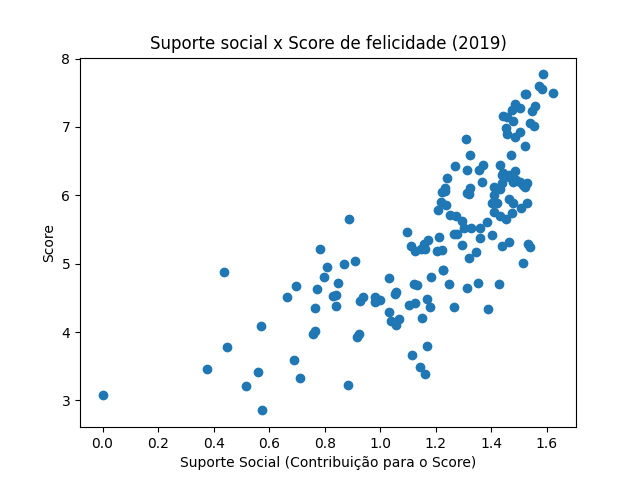
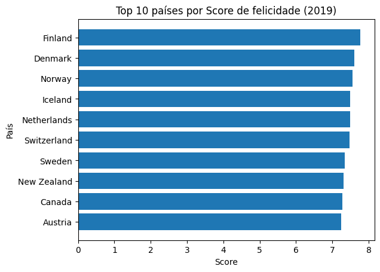
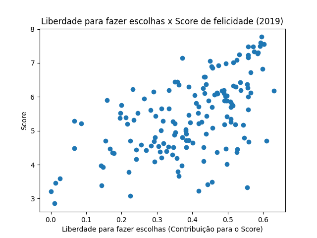

# Análise do Relatório Mundial de Felicidade (2019)

**Candidato:** Leonardo Dantas Andrade de Alencar
**Processo seletivo:** SYNAPTA | Laboratório de Dados e Inteligência Artificial, UNINASSAU Maceió (Edital nº 1/2026, Etapa 2)
**Opção escolhida:** Opção 2, Análise do Relatório Mundial de Felicidade

## Objetivo e pergunta orientadora

Analisar indicadores de felicidade de 156 países e responder:

> Quais fatores aparecem associados às maiores pontuações de felicidade e quais cuidados devem ser tomados ao interpretar essa relação?

## Dataset

- **Fonte:** [World Happiness Report (Kaggle, Sustainable Development Solutions Network)](https://www.kaggle.com/datasets/unsdsn/world-happiness)
- **Arquivo utilizado:** `2019.csv`
- **Licença:** CC0 1.0 Universal (domínio público), conforme a página do dataset. Por isso o arquivo está incluído em `data/`.

## Colunas utilizadas

O dataset é centrado na coluna `Score`. As demais colunas de fatores estimam o quanto cada fator contribui para o `Score` de cada país.

| Coluna | O que representa |
|---|---|
| `Country or region` | Nome do país. Cada linha é um país. |
| `Score` | Média das notas que as pessoas dão à própria vida, numa escala de 0 a 10 (pergunta da "escada" da pesquisa Gallup World Poll). |
| `Social support` | Estimativa de quanto o suporte social contribui para o `Score` do país. **Não** é o valor bruto do indicador. |
| `Freedom to make life choices` | Estimativa de quanto a liberdade para fazer escolhas de vida contribui para o `Score` do país. **Não** é o valor bruto do indicador. |

As colunas de fatores medem a contribuição em relação à "Distopia", um país hipotético com as piores médias do mundo em cada fator. Por isso o mínimo delas é 0. Um valor 0 significa que o fator contribuiu zero para o `Score` daquele país, e não que o fator não existe nele.

Ao somar as seis colunas de fatores da Finlândia, o resultado foi 5,055, e não 7,769. A diferença vem do componente da Distopia e de um resíduo, que é a parte que o modelo não explica.

## Ferramentas

- Python 3, Google Colab
- pandas (leitura e análise dos dados)
- matplotlib (gráficos)

## Como executar

1. Baixe este repositório ou abra o notebook `ETAPA_2_Leonardo_Dantas_Andrade_de_Alencar_01701668.ipynb` no Google Colab.
2. O arquivo `data/2019.csv` está no repositório. Caso prefira baixar do Kaggle, use o link da seção "Dataset" e pegue o `2019.csv`.
3. No Colab, envie o `2019.csv` pelo painel de arquivos (ícone de pasta). O notebook lê o arquivo com `pd.read_csv('2019.csv')`.
4. Para rodar localmente, instale as dependências com `pip install -r requirements.txt` e execute o notebook com o `2019.csv` na mesma pasta.
5. Execute as células na ordem.

## Limpeza e preparação dos dados

- **Tamanho:** 156 linhas (países) e 9 colunas (`df.shape`).
- **Valores ausentes:** nenhum (`df.isnull().sum()` deu 0 em todas as colunas).
- **Duplicados:** nenhum, tanto na linha inteira (`df.duplicated().sum()`) quanto só pela coluna de país (`df.duplicated(subset=["Country or region"]).sum()`). A segunda checagem foi necessária porque o `Overall rank` é diferente em toda linha, então a primeira não encontraria um país repetido com dados diferentes.
- **Inconsistências:** nenhum valor negativo; o `Score` fica entre 2,853 e 7,769, faixa coerente para uma nota de 0 a 10 (`df.describe()`).
- **Decisão:** nenhuma alteração foi necessária nos dados.

## Resultados

### Média e mediana do Score

A média do `Score` é aproximadamente **5,407** e a mediana é **5,3795** (valores do `df.describe()`). A média representa a nota média se todos os 156 países fossem tratados igualmente. A mediana é o valor central: metade dos países está abaixo dela e metade acima.

### Top 10 e bottom 10 (`df.nlargest` e `df.nsmallest`)

| # | Maiores pontuações | Score | | Menores pontuações | Score |
|---|---|---|---|---|---|
| 1 | Finlândia | 7,769 | | Sudão do Sul | 2,853 |
| 2 | Dinamarca | 7,600 | | República Centro-Africana | 3,083 |
| 3 | Noruega | 7,554 | | Afeganistão | 3,203 |
| 4 | Islândia | 7,494 | | Tanzânia | 3,231 |
| 5 | Países Baixos | 7,488 | | Ruanda | 3,334 |
| 6 | Suíça | 7,480 | | Iêmen | 3,380 |
| 7 | Suécia | 7,343 | | Malawi | 3,410 |
| 8 | Nova Zelândia | 7,307 | | Síria | 3,462 |
| 9 | Canadá | 7,278 | | Botsuana | 3,488 |
| 10 | Áustria | 7,246 | | Haiti | 3,597 |

### Correlação do Score com dois fatores

| Fator | Correlação com o Score |
|---|---|
| Suporte social | 0,777 |
| Liberdade para fazer escolhas | 0,567 |

Ambas são positivas, e o suporte social apresentou a associação mais forte. Isso contraria minha hipótese inicial, de que a liberdade acompanharia mais de perto o `Score`.

### Gráficos

**Gráfico 1: Suporte social x Score**



Cada ponto é um país. A nuvem sobe da esquerda para a direita: países em que o suporte social contribui mais para o Score tendem a ter Score maior. Os países com Score alto ficam concentrados na faixa alta de suporte social, enquanto os de Score baixo variam bastante.

**Gráfico 2: Top 10 países por Score**



Gráfico de barras horizontais com os 10 países de maior Score, da Finlândia à Áustria. As barras têm tamanhos muito parecidos, o que indica que o topo do ranking é bem apertado: a diferença entre o 1º e o 10º é de cerca de 0,5 ponto.

**Gráfico 3: Liberdade para fazer escolhas x Score**



Cada ponto é um país. A tendência também é de subida, mas a nuvem é mais espalhada que a do suporte social, o que combina com a correlação mais fraca (0,567). Para uma mesma contribuição da liberdade, os Scores variam bastante, então esse fator sozinho acompanha menos o Score.

## Conclusões

1. **O topo é dominado por países europeus, principalmente nórdicos.** Os 10 maiores Scores vão de 7,246 (Áustria) a 7,769 (Finlândia), com Dinamarca, Noruega, Islândia, Países Baixos, Suíça e Suécia entre eles. Canadá e Nova Zelândia são as exceções.
2. **A base do ranking é bem mais baixa e mais espalhada.** Os 10 menores vão de 2,853 (Sudão do Sul) a 3,597 (Haiti), uma faixa de cerca de 0,7 contra cerca de 0,5 do topo.
3. **O suporte social tem a associação mais forte com o Score.** A correlação foi de 0,777, e no gráfico os pontos sobem da esquerda para a direita.
4. **A liberdade de escolhas tem associação moderada.** A correlação foi de 0,567 e a nuvem de pontos é mais espalhada. Isso contrariou minha hipótese inicial.
5. **Há exceções à tendência.** Botsuana e Iêmen têm suporte social alto (1,145 e 1,163, respectivamente) e Score baixo (3,488 e 3,380), então um fator alto não garante um Score alto.

## Correlação não é causa

A correlação ou associação indica que dois valores têm tendência a variar juntos, mas não prova que um cause o outro. O suporte social (correlação de 0,777) pode acompanhar um Score alto sem ser a única causa da felicidade. Pode haver outros fatores influenciando os dois ao mesmo tempo, e a relação pode até ser no sentido contrário: pessoas felizes podem relatar mais suporte social.

## Limitações

- **Diferenças culturais:** o Score vem de uma nota que as pessoas dão à própria vida, e culturas diferentes podem avaliar e responder de formas diferentes, o que dificulta a comparação entre países.
- **Método de pesquisa:** o Score vem de amostras da pesquisa Gallup World Poll, e não de toda a população. As colunas dos fatores são estimativas de um modelo estatístico, e não medidas diretas.
- **Retrato de um período:** o arquivo é referente a 2019. Não mostra mudanças ao longo do tempo, e eventos posteriores podem ter alterado o cenário. Além disso, a descrição do dataset no Kaggle é de uma edição anterior do relatório (cita amostras de 2013 a 2016 e uma coluna "Family"), então não foi usada para afirmar o período exato dos dados de 2019.
- **Análise simples:** foi usada correlação entre duas variáveis, sem controlar outros fatores. Países como Iêmen e Botsuana mostram que há exceções.
- **Seleção de fatores:** só foram analisados dois fatores (suporte social e liberdade). PIB per capita, expectativa de vida saudável, generosidade e percepção de corrupção ficaram de fora.
- **Possível extensão:** analisar por continente ou região. O arquivo de 2019 não traz essa informação.

## Declaração de uso de inteligência artificial generativa

- **Ferramenta:** Claude (Anthropic).
- **Finalidade:** usei como tutor durante o desafio, para orientar o raciocínio, explicar conceitos (média, mediana, percentis, correlação), ajudar a interpretar mensagens de erro e sugerir rascunhos de textos (conclusões, limitações, explicações dos gráficos) e a estrutura deste README, que adaptei com minhas palavras.
- **O que fiz sozinho:** escrevi e executei o código no Google Colab, corrigi os erros que apareceram, escolhi os fatores e fiz a hipótese inicial.
- **Como verifiquei:** todos os números (dimensões, ausentes, duplicados, média, mediana, top 10, bottom 10 e correlações) vieram da execução do meu notebook. Os gráficos foram conferidos visualmente. A escala de 0 a 10, a origem dos dados (Gallup World Poll) e o significado das colunas de fatores foram conferidos na descrição do dataset no Kaggle.

## Estrutura do repositório

```
├── README.md
├── requirements.txt
├── ETAPA_2_Leonardo_Dantas_Andrade_de_Alencar_01701668.ipynb
├── data/
│   └── 2019.csv
└── images/
    ├── grafico1.png  (suporte social x Score)
    ├── grafico2.png  (top 10)
    └── grafico3.png  (liberdade x Score)
```
